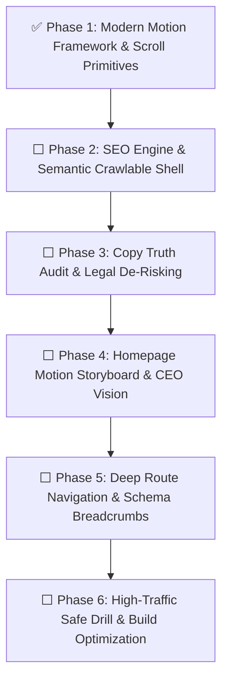

# AXINIX TECHNOLOGIES — External Website Transformation Roadmap

> **Document Reference:** `AXN-WEB-TRANSFORMATION-2026`  
> **Status:** ACTIVE EXECUTION — PHASE-BY-PHASE  
> **Target Application:** `External/` (Axinix Technologies Client-Facing Portal)  
> **Primary Product Spotlight:** **Workhub** (v4.1.1 Modular Business Operating Platform)  
> **Repository:** `d:\Tracer-V2\tracker-v2\External`

---

## 1. Ground Truth & Anti-Hallucination Standard

This project is governed by strict truth-in-advertising and legal de-risking principles. No AI-generated filler, fake SLA numbers (e.g. "99.99%"), or unverified latency claims ("sub-millisecond") are permitted.

### 1.1 Company Identity & Mandate
* **Mission Mandate:** Axinix Technologies exists as a technology solutions enterprise dedicated to analyzing real-world operational challenges from the ground up and engineering purpose-built solutions across industry sectors.
* **The Core Bottleneck Solved:** Modern enterprises suffer from **Application Sprawl**—fragmented toolchains, constant browser tab-switching, isolated software subscriptions, and fragile CSV export/sync scripts.
* **The Axinix Solution:** A single secure portal unifying all cross-functional business modules into a shared data pipeline with physical database-per-tenant isolation.
* **Strategic Ambition:**
  * **3-Year Milestone:** High-precision Custom ERP & CRM deployments tailored to vertical workflows across manufacturing, retail, and service industries.
  * **15-Year Milestone:** An integrated technology enterprise delivering foundational enterprise platforms, infrastructure, and hardware systems.

### 1.2 Flagship Product: Workhub (v4.1.1)
Axinix Technologies' current primary product is **Workhub**, a modular business operating platform unifying:
1. **Users & Identity:** RBAC, ABAC, granular permission versioning.
2. **HRMS:** Lifecycle history, statutory compliance, employee dossiers.
3. **Attendance:** Live punch tracking, leaves, comp-off, holiday calendars.
4. **Payroll:** Salary structures, automated payroll runs, payslips, expense claims.
5. **CRM & Deals:** Lead management, pipelines, meetings, quotation generation.
6. **Tasks & Sprints:** Boards, milestones, time tracking, daily logs.
7. **Support Help Desk:** SLA tickets, audit trails, multi-agent participation.
8. **Billing & Invoicing:** GST tax invoices, order acknowledgments, payment ledgers.
9. **Asset Management:** Procurement, allocation, physical stock ledger, depreciation.
10. **Recruitment:** Job requisitions, candidate pipelines, onboarding checklists.
11. **Internal Feed & Messaging:** Real-time departmental channels and alerts.
12. **Cross-Platform Delivery:** Web (React 19 + Vite) + Mobile (Flutter iOS & Android).

---

## 2. World-Class Website Inspirations (Benchmarks for Axinix)

To avoid the generic, flat "AI-generated template" aesthetic, we benchmark against top-tier enterprise engineering websites:

| Benchmark | Key Visual & Motion Mechanism | How We Adapt It for Axinix |
| :--- | :--- | :--- |
| **Linear.app** (`linear.app`) | Obsidian dark canvas, razor-sharp typography, layered glass surfaces (`backdrop-blur-xl`), and sticky interactive product demos that evolve on scroll. | **Workhub Interactive Canvas:** The hero preview transforms as the user scrolls, highlighting HRMS -> Tasks -> CRM -> Billing with live UI state tabs. |
| **Raycast** (`raycast.com`) | Command-grade feel, subtle luminous border glows, magnetic micro-interactions, zero fluff copy. | **Axinix Brand Glows & Badges:** Gold and electric cyan luminous highlights, keyboard-ready search, dense metric indicators without empty containers. |
| **Stripe** (`stripe.com`) | Enterprise gravitas, multi-layer ambient mesh gradients, animated tab transitions with `layoutId`, rock-solid trust indicators. | **Ecosystem Showcase:** Smooth animated transitions between Solutions, Industries, and Platform Architecture. |
| **Ramp** (`ramp.com`) | Story-driven scroll comparison (Problem vs. Solution) showing real financial clarity instead of exaggerated promises. | **Operational Comparison Section:** Visual interactive comparison of "Traditional Fragmented Toolchain" vs. "Axinix Unified Portal Architecture". |
| **Vercel** (`vercel.com`) | Pre-rendered crawlable semantic shell, instant time-to-first-byte, zero-FOUC theme hydration, and technical precision copy. | **SEO Engine & Pre-Render Shell:** Complete crawlability for Googlebot and AI crawlers with static `robots.txt`, `sitemap.xml`, and `llms.txt`. |

---

## 3. Phased Implementation Roadmap

### ✅ Phase 1: Modern Motion Framework & Scroll Storyboard Primitives
* **Status:** COMPLETED
* **Delivered Artifacts:**
  * [x] `motion` v14 (React 19 compatible) installed in `External/package.json`.
  * [x] `External/src/components/motion/ScrollReveal.jsx`: Directional viewport reveals with cubic-bezier easing.
  * [x] `External/src/components/motion/StaggerContainer.jsx` & `StaggerItem.jsx`: Coordinated child reveals for grids and cards.
  * [x] `External/src/components/motion/ScrollStoryboardSection.jsx`: Scroll-progress-linked continuous transforms (`useScroll`, `useTransform`).
  * [x] `External/src/components/motion/PageTransition.jsx`: Route-level enter/exit with `<AnimatePresence mode="wait">`.
  * [x] `External/src/components/motion/index.js`: Clean barrel exports.
  * [x] Integrated `PageTransition` inside `External/src/layouts/MainLayout.jsx` wrapping `<Outlet />`.
  * [x] Accessibility support: Automatic bypass via `useReducedMotion()`.
  * [x] Production build verified cleanly (4.75s).

---

### ⬜ Phase 2: SEO Engine, Semantic Crawlable Pre-Render Shell & Static Directives
* **Status:** UPCOMING / NEXT
* **Scope:** Replicate `D:\E-commerce`'s search engine indexing architecture.
* **Tasks:**
  * [ ] Pre-rendered semantic HTML shell embedded inside `
` in `External/index.html` (crawlable H1, H2, body copy before JS executes).
  * [ ] Accessible `<noscript>` fallback navigation block in `External/index.html`.
  * [ ] `External/src/components/SeoHead.jsx`: Dynamic `<title>`, canonical `<link>`, meta description, OpenGraph, and Twitter tags per route.
  * [ ] Inject Schema.org JSON-LD microdata (`Organization`, `WebSite`, `SoftwareApplication`).
  * [ ] `External/public/robots.txt`: Comprehensive directives for Googlebot, Bingbot, GPTBot, ClaudeBot, PerplexityBot.
  * [ ] `External/public/sitemap.xml`: Complete canonical URL index.
  * [ ] `External/public/llms.txt`: Structured company and taxonomy context for AI search engines.
* **Acceptance Criteria:**
  - Raw HTTP GET to `index.html` yields structured semantic headings and copy.
  - Every page dynamically updates document title and social card metadata.
  - Search crawler directives return HTTP 200 with valid syntax.

---

### ⬜ Phase 3: Copy Truth Audit & Legal De-Risking (Workhub & Axinix Truth)
* **Status:** QUEUED
* **Scope:** Eradicate all AI-generated placeholder copy and replace with authentic Axinix identity and Workhub capabilities.
* **Tasks:**
  * [ ] Scrub `HeroBanner.jsx`: Remove `"99.99% Enterprise SLA"`, replace with verified architectural attributes.
  * [ ] Scrub `StatsSection.jsx` and `RoiCalculator.jsx`: Ground metrics in real operational efficiency (elimination of tab sprawl, centralized databases).
  * [ ] Align all product messaging with **Workhub v4.1.1** modules: HRMS, Attendance, Payroll, CRM, Tasks, Support Tickets, Billing, and Assets.
  * [ ] Ensure all legal and policy links reflect Axinix Technologies' registered standards.
* **Acceptance Criteria:**
  - Zero unverified claims or contractual liabilities.
  - No generic AI buzzwords; tone is disciplined, authoritative B2B software engineering.

---

### ⬜ Phase 4: Homepage Motion Storyboard & CEO / Leadership Vision Section
* **Status:** QUEUED
* **Scope:** Re-engineer the homepage into a cohesive scroll-driven product storyboard.
* **Tasks:**
  * [ ] Choreograph Hero with `ScrollReveal` and multi-layer entrance motion.
  * [ ] Rebuild `DashboardPreview` as an interactive Workhub module explorer (HRMS, CRM, Tasks, Billing) with smooth layout animations.
  * [ ] Implement the **"CEO / Leadership Vision & Heading"** component:
    - Editorial serif heading: *"Why Axinix Exists: Engineering Solutions for Real-World Industry."*
    - Direct executive narrative detailing the fight against Application Sprawl.
    - 3-Year and 15-Year milestone horizon roadmap.
  * [ ] Interactive Operational Switcher: "Traditional Fragmented Toolchain" vs. "Axinix Unified Portal".
* **Acceptance Criteria:**
  - The page flows like a cohesive interactive narrative, not a static template.
  - The CEO / Leadership heading stands out prominently with authentic voice.

---

### ⬜ Phase 5: Deep Route Navigation, Dynamic URL Slugs & Schema Breadcrumbs
* **Status:** QUEUED
* **Scope:** Implement semantic URL routing and Schema.org breadcrumbs matching `D:\E-commerce`.
* **Tasks:**
  * [ ] Create `External/src/components/Breadcrumbs.jsx` with Schema.org `BreadcrumbList` JSON-LD microdata.
  * [ ] Create dynamic slug utilities in `External/src/utils/slugify.js`.
  * [ ] Upgrade Solutions, Services, and Industries pages to use crawlable `<Link to="...">` anchor elements.
  * [ ] Add dynamic detail routes for `/solutions/[id]`, `/services/[id]`, `/industries/[slug]`.
* **Acceptance Criteria:**
  - Full internal link crawlability for search engines.
  - Rich snippet breadcrumbs verified in Schema.org validation.

---

### 6. Phase 6: High-Traffic Safe Drill, Bundle Optimization & Production Verification
* **Status:** QUEUED
* **Scope:** Production hardening, security checks, and high-traffic performance testing.
* **Tasks:**
  * [ ] Manual Rollup chunk splitting in `vite.config.js` (`vendor-react`, `vendor-motion`, `vendor-router`, `vendor-icons`).
  * [ ] Production source maps disabled (`build.sourcemap: false`).
  * [ ] Centralized console sanitization (`logger.js`).
  * [ ] Zero-FOUC theme hydration verification.
  * [ ] Full build audit and deployment gate verification.
* **Acceptance Criteria:**
  - Production build bundles stay well under 250kB per split chunk.
  - Zero console errors or layout flashes on cold load.

---

## 4. Verification & Progress Log

| Date | Phase | Action / Milestone | Verification |
| :--- | :--- | :--- | :--- |
| **2026-11-12** | **Phase 1** | Installed `motion` v14, created `ScrollReveal`, `StaggerContainer`, `StaggerItem`, `ScrollStoryboardSection`, `PageTransition`, and integrated into `MainLayout.jsx`. | ✅ Vite production build passed in 4.75s with zero errors. |
| **2026-11-12** | **Pop-in & Reload** | Created `PagePreloader` brand reload experience, enhanced `ScrollReveal` & `StaggerItem` with spring `pop` physics, orchestrated Hero pop-in sequence, and scroll-triggered section pop-ins across `HomePage`. | ✅ Verified build in 5.65s; cold load and hard reload sequence active. |
| **2026-11-12** | **Alternating Split Showcase** | Created reusable `FeaturePageHeader`, `EmptyVisualPanel` (strictly zero content), `SectionLink`, `FeatureContentCard`, `AlternatingFeatureSection`, and `AlternatingFeatureShowcase` in `src/components/features/`. Created `AdminFeatureCardsTab` for full header & card CRUD with reordering and live alternating position badges, backed by `site_section_content` Populate API. Integrated into `HomePage`. | ✅ Verified Vite production build passed in 8.36s with zero errors. |

