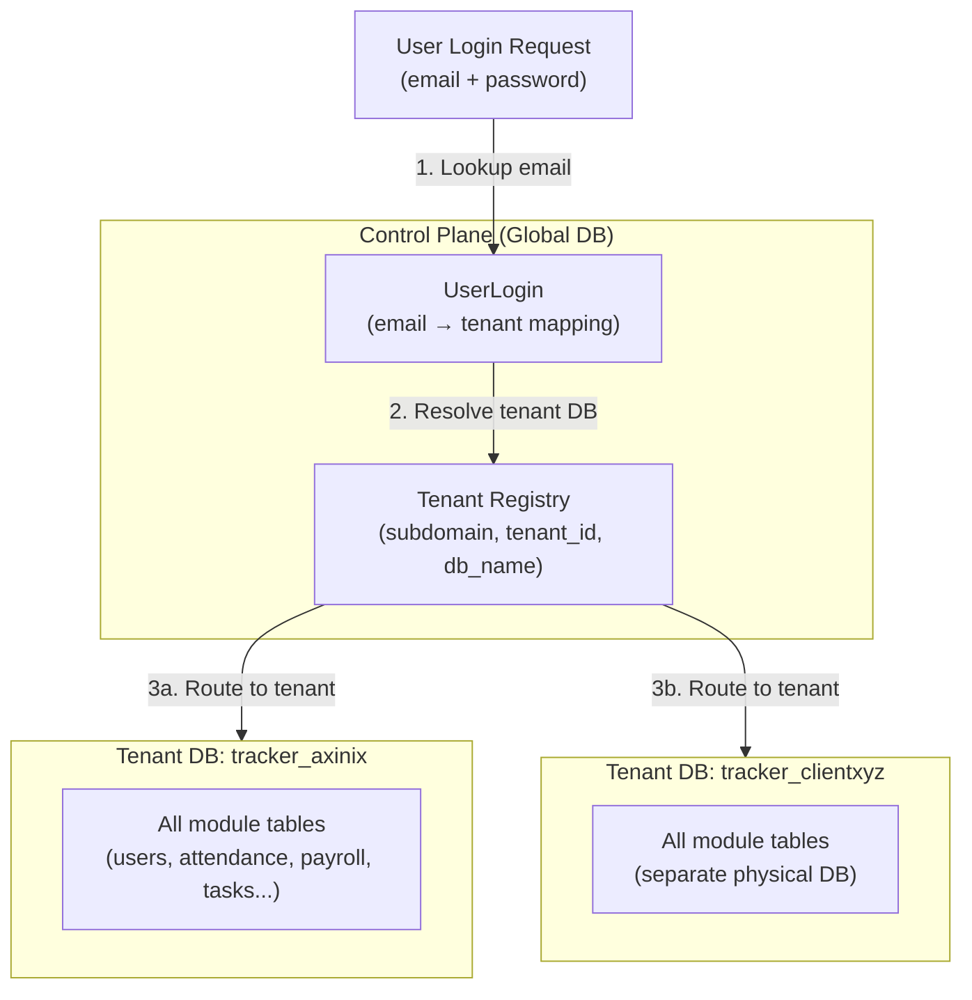

# Workhub — Product Overview

> **Document Reference:** AXN-DOCS-03-WH-001  
> **Last Updated:** 2026-11-11  
> **Repository:** `d:\Axinix Projects\tracker-v2`  
> **Version:** `4.1.1`  
> **Implementation Status:** ACTIVELY DEVELOPED — Production  
> **Authored By:** Axinix Technologies Documentation System

---

## 1. Overview

**Workhub** (product name: `workhub-tracker-v2`) is Axinix Technologies' flagship modular business operating platform. It provides organizations with a unified environment to manage human resources, attendance, payroll, projects, tasks, client relationships, support tickets, assets, billing, and internal communications.

Workhub is designed to replace multi-vendor tool fragmentation with a single cohesive portal where every department's workflows connect.

---

## 2. Core Characteristics

| Dimension | Detail |
|---|---|
| **Version** | `4.1.1` |
| **Backend** | Python / Django + Axinix Core |
| **Frontend** | React 19 + Vite (web) |
| **Mobile** | Flutter `4.1.1+1` (Android + iOS) |
| **Database** | MySQL (physical per-tenant isolation) |
| **Architecture** | Multi-tenant SaaS — one database per tenant |
| **API Pattern** | Axinix Core populate engine (`/api/populate/`) |
| **Auth** | JWT (PyJWT) + Axinix Core ABAC |
| **Min Client Version** | `3.0.0` |

---

## 3. Module Registry

All verified modules from backend directory structure and knowledge_brain INDEX.md:

| Module | Backend App | Purpose | Status |
|---|---|---|---|
| **Users** | `backend/users/` | Identity, authentication, RBAC, roles, departments, designations | ✅ IMPLEMENTED |
| **HRMS** | `backend/hr/` | Employee documents, lifecycle history, HR policies, user overrides | ✅ IMPLEMENTED |
| **Attendance** | `backend/attendance/` | Punch tracking, leaves, comp-off, holiday calendars, permissions | ✅ IMPLEMENTED |
| **Payroll** | `backend/payroll/` | Salary structures, payroll runs, payslips, expense reimbursements | ✅ IMPLEMENTED |
| **CRM** | `backend/crm/` | Leads, contacts, opportunities, deal pipeline, CRM meetings | ✅ IMPLEMENTED |
| **Task Management** | `backend/tasks/` | Boards, sprints, tasks, time tracking, daily activities | ✅ IMPLEMENTED |
| **Help Desk (Tickets)** | `backend/tickets/` | SLA support tickets, activity logs, participants, status transitions | ✅ IMPLEMENTED |
| **Billing** | `backend/billing/` | Quotations, order acknowledgements, invoices, payments, ledgers | ✅ IMPLEMENTED |
| **Recruitment** | `backend/recruitment/` | Job openings, candidates, onboarding templates, checklists | ✅ IMPLEMENTED |
| **Asset Management** | `backend/assets/` | Asset procurement, assignments, stock ledger, deprecation, invoices | ✅ IMPLEMENTED |
| **Dashboard** | `backend/dashboard/` | Dynamic role-based dashboard layouts, widgets, KPI aggregation | ✅ IMPLEMENTED |
| **Notifications** | `backend/notifications/` | Real-time event notifications, recipient isolation, anti-spoofing | ✅ IMPLEMENTED |
| **Activity Feed** | `backend/feed/` | Groups, channels, posts, comments, direct messaging | ✅ IMPLEMENTED |
| **Control Plane** | `backend/control_plane/` | Multi-tenant org directory, user login routing, database provisioning | ✅ IMPLEMENTED |
| **System** | `backend/system/` | Status configs, email SMTP, workflows, release notes, products | ✅ IMPLEMENTED |
| **Travel & Expenses** | (inferred from knowledge_brain) | Travel expense management | ⚠️ REQUIRES DEEPER INSPECTION |

---

## 4. Multi-Tenant Architecture

Workhub uses **physical database-per-tenant isolation**:



**Tenant database naming convention:** `tracker_<subdomain>` (from `control_plane` knowledge brain)

---

## 5. Verified Data Models (from `users/models.py`)

### Core Identity Models

```python
# Role — RBAC role definition
@register_model("role", table_type="master")
class Role(models.Model):
    name: CharField(max_length=64, unique=True)
    is_superadmin: BooleanField(default=False, db_index=True)
    permission_version: PositiveIntegerField
    status: SmallIntegerField(default=1)
    # DB table: "roles"

# Department
@register_model("department", table_type="master")
class Department(models.Model):
    name: CharField(max_length=128, unique=True)
    short_code: CharField(max_length=32, unique=True)
    # DB table: "departments"

# Designation
@register_model("designation", table_type="master")
class Designation(models.Model):
    title: CharField(max_length=128, unique=True)
    # DB table: "designations"

# Company
@register_model("company", table_type="master")
class Company(models.Model):
    name: CharField(max_length=255)
    code: CharField(unique=True)
    # DB table: "companies"

# Client
@register_model("client", table_type="master", aliases=["clients"])
class Client(models.Model):
    name: CharField(max_length=255, unique=True)
    owner_name: CharField
    business_type: CharField
    # DB table: derived from model
```

---

## 6. Frontend Architecture

The React 19 + Vite web application (`Frontend/src/`) is organized as:

| Directory | Purpose |
|---|---|
| `api/` | Axinix Core populate API client + axios interceptors |
| `components/` | Reusable UI components (organized by module) |
| `constants/` | Frontend constants and config |
| `context/` | React context providers (Auth, Theme, etc.) |
| `design/` | Design system and tokens |
| `engine/` | Frontend processing engine |
| `hooks/` | Custom React hooks |
| `layouts/` | Page layout components |
| `pages/` | File-based routing (153 route files, Vite Plugin Pages) |
| `platformAdmin/` | Platform admin panel |
| `providers/` | Data providers |
| `services/` | Service layer |
| `store/` | State management |
| `styles/` | Global styles |
| `utilities/` | Utility functions |

**Frontend API Contract (from knowledge brain Phase 8):**

| Frontend call | Backend endpoint |
|---|---|
| `PopulateApi.read('tasks', {...})` | `POST /api/populate/read/tasks` |
| `PopulateApi.create('task', data)` | `POST /api/populate/create/task` |
| `PopulateApi.update('task', id, data)` | `POST /api/populate/update/task/{id}` |
| `PopulateApi.delete('task', id)` | `POST /api/populate/delete/task/{id}` |
| `PopulateApi.report('task', params)` | `POST /api/populate/report/task` |
| `/auth/login` | `users/urls.py → login view` |
| `/auth/me` | `users/urls.py → me view` |
| `/auth/me/context` | `users/urls.py → context view` |
| `/auth/change-password` | `users/urls.py → change password view` |

**Registered Model Aliases (frontend → backend):**

| Frontend alias | Backend model |
|---|---|
| `tasks` | `Task` |
| `tickets` | `Ticket` |
| `employees` | `Employee` |
| `clients` | `Client` |
| `project_types` | `ProjectType` |
| `payroll_runs` | `PayrollRun` |
| `payslips` | `Payroll` |
| `salary_structures` | `SalaryStructure` |
| `shifts` | `Shift` |
| `departments` | `Department` |
| `dashboard_schemas` | `DashboardSchema` |
| `dashboard_widgets` | `DashboardWidget` |

**Build Performance:**
- 5,412 modules compiled in 22.88s (Vite production build)
- Zero oversized chunks (all under 600 kB)
- Production source maps disabled (security)
- Vendor chunk split: react, router, icons, network, geo, excel, editor

---

## 7. Mobile Application (Flutter)

**Repository path:** `tracker-v2/tracker_mobile/`  
**Version:** `4.1.1+1` (synchronized with platform)  
**Package name:** `work_hub`

**Supported platforms:** Android, iOS (primary), Web, Linux, macOS, Windows

**Key capabilities from pubspec.yaml:**
- HTTP: `dio` (REST API calls)
- Auth: `jwt_decoder` (token decoding), `dio_cookie_manager` (session cookies)
- UI: `shimmer` (loading skeletons), `lucide_icons_flutter`, `flutter_svg`, `cached_network_image`
- File: `file_picker`, `image_picker`, `camera`
- Storage: `shared_preferences`
- Network: `connectivity_plus`
- State: `provider`

---

## 8. Business Workflow Details (from Knowledge Brain)

### Payroll State Machine

```
SalaryStructure (versioned) → PayrollRun (Draft → Processing → Computed → Approved → Paid)
                                      ↓
                             Payroll (immutable payslip, frozen on Approved)
```

### Billing/Invoicing State Machine

```
Quotation (auto-numbered QUO-YYYY-XXXX)
    → QuotationRevision (immutable snapshot on revision)
    → OrderAcknowledgement (OA-YYYY-XXXX)
    → Invoice (INV-YYYY-XXXX): Draft → Issued → Partially Paid → Paid
    → Payment + PaymentJournal (RCT-YYYY-XXXX)
    → ClientLedger (double-entry debit/credit)
    → PeriodClosure (accounting period lock)
```

### CRM Opportunity Probability Mapping

```
New (10%) → Discovery (20%) → Proposal (50%) → Negotiation (80%) → Won (100%) / Lost (0%)
```

### Recruitment Pipeline

```
JobOpening → Candidate (APP-YYYY-XXXX) → Interview → Offer → Hired (quota +1)
                              ↓
                     Onboarding (from OnboardingTemplate)
```

---

## 9. Security Architecture

| Mechanism | Implementation |
|---|---|
| **Multi-tenant isolation** | `TenantDatabaseRouter` (Axinix Core) |
| **Password hashing** | PBKDF2 via `django.contrib.auth.hashers.make_password` |
| **Password never exposed** | `password` in `get_forbidden_fields()` (service-level) |
| **Privilege escalation guard** | `is_superadmin`, `is_superuser`, `role` mutations require `context.is_superadmin` |
| **Notification scoping** | `before_read` enforces `Q(recipient=context.user)` |
| **Email config protection** | SMTP passwords in `get_forbidden_fields()` |
| **ABAC policies** | `AccessPolicy` DB records evaluated by `PolicyEngine` |
| **Rate limiting** | Redis sliding-window (Axinix Core) |

---

## 10. Development Workflow

**Git branching pattern:**
- `main` — production-ready
- `staging` — pre-production integration
- `feat/<name>` / `feature/<name>` — feature branches
- `bug-fix/<name>` — bug fix branches
- `hotfix/<name>` — urgent production fixes
- `core/<name>` — core architecture changes

**Version management:**
- `version.json` as single source of truth
- `npm run version:bump:patch/minor/major` to increment
- `npm run version:sync` to propagate to all targets
- Mobile Flutter version synchronized manually to `pubspec.yaml`

---

## 11. Known Development Status

| Component | Status | Notes |
|---|---|---|
| Jarvis AI Assistant | IN DEVELOPMENT | Branch `feat/jarvis-ai-assistant` exists |
| Advanced Communication/Chat | IN DEVELOPMENT | Branch `feat/advanced-communication-chat` |
| Dashboard Charts Builder | IN DEVELOPMENT | Branch `feat/dashboard-actions-charts-builder` |
| Travel & Expenses module | PARTIAL | Present in knowledge_brain, needs source inspection |
| DailyTracker module | PARTIAL | AI-powered daily work status and reporting (AI substrate referenced) |

---

## 12. Related Documents

- [Module Documentation Index](./modules/) — *(to be created per module)*
- [Database Architecture](./DATABASE-ARCHITECTURE.md) — *(to be created)*
- [API Documentation](./API-DOCUMENTATION.md) — *(to be created)*
- [Frontend Architecture](./FRONTEND-ARCHITECTURE.md) — *(to be created)*
- [Mobile Architecture](./MOBILE-ARCHITECTURE.md) — *(to be created)*
- [../../../02-shared-technology/axinix-core/ARCHITECTURE.md](../../02-shared-technology/axinix-core/ARCHITECTURE.md) — Axinix Core documentation
- [REPOSITORY-INVENTORY.md](../../../00-discovery/REPOSITORY-INVENTORY.md)

---

## 13. Source File References

| Component | File |
|---|---|
| Knowledge Brain Index | [`knowledge_brain/INDEX.md`](file:///d:/Axinix%20Projects/tracker-v2/knowledge_brain/INDEX.md) |
| Backend Users Models | [`backend/users/models.py`](file:///d:/Axinix%20Projects/tracker-v2/backend/users/models.py) |
| Version Metadata | [`version.json`](file:///d:/Axinix%20Projects/tracker-v2/version.json) |
| Mobile pubspec | [`tracker_mobile/pubspec.yaml`](file:///d:/Axinix%20Projects/tracker-v2/tracker_mobile/pubspec.yaml) |
| Backend Requirements | [`backend/requirements.txt`](file:///d:/Axinix%20Projects/tracker-v2/backend/requirements.txt) |

