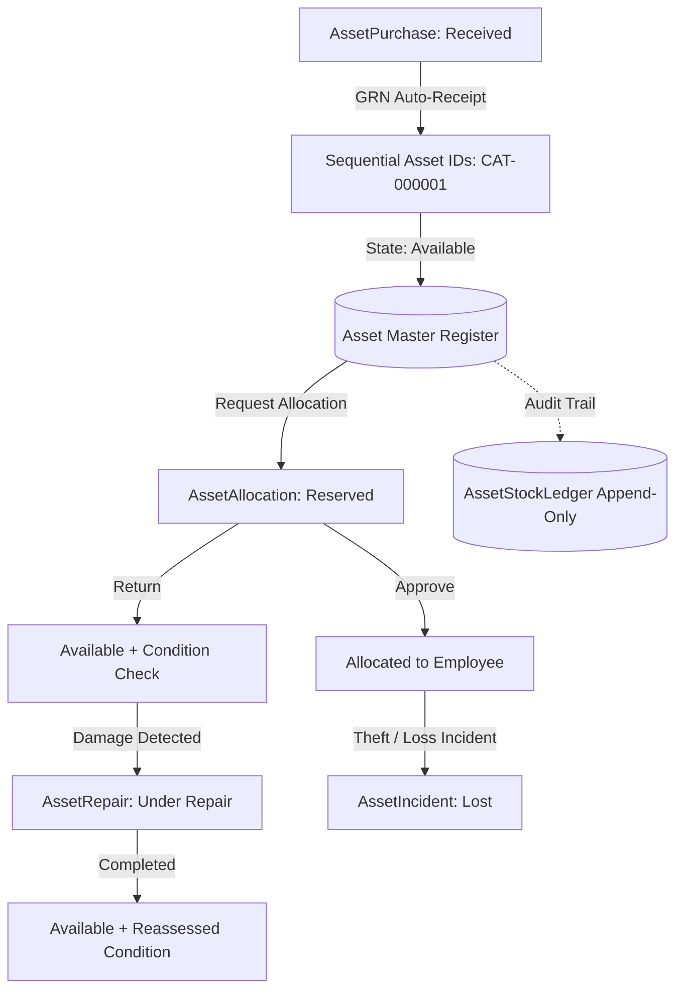

# Assets Module Brain (Django + Populate Core)

## Overview
The Assets module handles organizational asset tracking, dynamic category short codes, lifecycle status state machines, employee allocations/transfers/returns, damage reporting (incidents), external vendor repairs, and an append-only stock audit ledger.

All operations flow strictly through the 10-stage Populate Core Pipeline (`/api/populate/:action/:model/`) on MySQL (`workhub_db`), utilizing domain services in `assets/services.py` with zero custom controllers.

---

## 🏗️ Architecture & Component Relations

---

## 🗄️ Backend Models (`assets/models.py`)

| Model | Table | Type | Description | Key Fields | Composite Indexes |
| :--- | :--- | :--- | :--- | :--- | :--- |
| **AssetCategory** | `assets_categories` | Master | Asset classification & prefix generator. | `name`, `code` (e.g. `LAP`, `MON`), `depreciation_rate`, `warranty_months`, `is_active`, `status` | `(status, name)` `(status, code)` |
| **AssetVendor** | `assets_vendors` | Master | Hardware suppliers & repair service centers. | `name`, `contact_person`, `phone`, `email`, `gstin`, `address`, `status` | `(status, name)` |
| **AssetPurchase** | `assets_purchases` | Transaction | Purchase orders & GRN automated receipt. | `vendor`, `po_number`, `purchase_date`, `purchase_status`, `items` (JSON), `total_amount`, `paid_amount`, `payment_status` | `(status, purchase_status, purchase_date)` |
| **Asset** | `assets` | Master | Master asset register with dynamic ID. | `asset_id` (e.g. `LAP-000001`), `category`, `name`, `serial_number`, `make`, `model`, `asset_status`, `condition`, `current_allocated_to` | `(status, asset_status, created_at)` `(status, category_id, asset_status)` `(status, current_allocated_to, asset_status)` |
| **AssetAllocation**| `assets_allocations` | Transaction | Employee checkout, return, and transfers. | `asset`, `employee`, `allocation_type`, `allocation_status`, `returned_condition`, `transfer_from_employee`, `transfer_to_employee` | `(status, allocation_status, allocation_date)` `(status, employee_id, allocation_status)` `(status, asset_id, allocation_status)` |
| **AssetIncident** | `assets_incidents` | Transaction | Damage, theft, or loss tracking. | `asset`, `employee`, `incident_type`, `description`, `recovery_amount`, `recovery_approved`, `incident_status` | `(status, incident_status, incident_date)` `(status, asset_id, incident_type)` |
| **AssetRepair** | `assets_repairs` | Transaction | External repair checkout and return. | `asset`, `incident`, `vendor_name`, `sent_date`, `repair_cost`, `repair_condition`, `repair_status` | `(status, repair_status, sent_date)` `(status, asset_id, repair_status)` |
| **AssetStockLedger**| `assets_stock_ledgers`| Ledger | Immutable append-only audit trail. | `asset`, `transaction_type` (`IN`/`OUT`), `trigger_type`, `previous_state`, `new_state`, `performed_by` | `(status, transaction_date)` `(status, asset_id, transaction_date)` |

---

## ⚙️ Domain Services & State Machine Governance (`assets/services.py`)

### 1. Dynamic Short Code Resolution (`AssetService`)
- Short codes are **NEVER hardcoded or assumed**.
- Derived strictly from `AssetCategory.code` configured by the user in the master table (e.g., `LAP` for Laptop, `MON` for Monitor).
- Sequenced dynamically with zero-padding: `{category.code}-{sequence:06d}` (e.g. `LAP-000001`, `MON-000002`).
- Locked atomically per category row (`select_for_update`) to prevent duplicate ID generation under concurrency.

### 2. Transition-Based Side Effects (Zero Duplicate Ledger Entries)
- Hooks capture `context.metadata["prev_status"]` in `before_update`.
- In `after_update`, side effects (updating asset status, assigning employee holder, and writing `AssetStockLedger`) execute **strictly when the status changes**.
- Unrelated updates (e.g., editing return notes, remarks, or serial numbers) do not duplicate ledger writes.

### 3. Automated GRN Goods Receipt (`AssetPurchaseService`)
- When `purchase_status` transitions from any state to `"Received"`:
  - Validates all purchase line items (positive integer quantities, valid categories, non-negative prices).
  - Iterates over unreceived line quantities.
  - Generates $N$ unique `Asset` records with category short codes.
  - Logs mandatory `IN` (`Purchase_Receipt`) stock ledger entries within `transaction.atomic()`.

### 4. Allocation State Machine (`AssetAllocationService`)
- **Request**: Atomically checks asset availability with `select_for_update()` and reserves asset (`Reserved`).
- **Approval (`Active`)**: Sets `Asset.asset_status="Allocated"`, records `current_allocated_to`, logs `OUT` (`Employee_Allocation`).
- **Return (`Returned`)**: Resets `Asset.asset_status="Available"`, clears assignee, reassesses `Asset.condition` from `returned_condition`, logs `IN` (`Employee_Return`).
- **Transfer (`Transferred`)**: Reassigns `Asset.current_allocated_to` to `transfer_to_employee`, logs `OUT` (`Employee_Allocation`).

### 5. Repair Lifecycle (`AssetRepairService`)
- **Checkout**: Validates asset eligibility (cannot repair disposed or lost items), sets `Asset.asset_status="Under Repair"`, logs `OUT` (`Send_To_Repair`).
- **Completion (`Repaired`)**: Resets `Asset.asset_status="Available"`, updates `Asset.condition=repair_condition`, logs `IN` (`Repair_Return`).
- **Disposal (`Beyond Repair`)**: Sets `Asset.asset_status="Disposed"`, logs `OUT` (`Write_Off_Disposal`).

### 6. Incident Reporting (`AssetIncidentService`)
- Anti-spoofing: ordinary employees can only submit incidents for themselves.
- Loss/Theft: Sets `Asset.asset_status="Lost"`, logs `OUT` (`Incident_Loss`) with accurate `new_state="Lost"`.

---

## 🔗 Unified API Reference

All requests route through `/api/populate/:action/:model/`:

| Capability | Method | Endpoint | Example Payload |
| :--- | :--- | :--- | :--- |
| **Create Category** | POST | `/api/populate/create/asset_category/` | `{"name": "Laptops", "code": "LAP"}` |
| **Create Vendor** | POST | `/api/populate/create/asset_vendor/` | `{"name": "Dell Enterprise", "phone": "+1-800-DELL"}` |
| **Create PO** | POST | `/api/populate/create/asset_purchase/` | `{"vendor": 1, "items": [{"category_id": 1, "name": "Dell XPS 15", "quantity": 5, "unit_price": 1200.00}]}` |
| **Receive PO (GRN)**| POST | `/api/populate/update/asset_purchase/:id/`| `{"purchase_status": "Received"}` |
| **Register Asset** | POST | `/api/populate/create/asset/` | `{"category": 1, "name": "Dell XPS 15", "make": "Dell", "model": "9520"}` |
| **Request Checkout**| POST | `/api/populate/create/asset_allocation/`| `{"asset": 1, "employee": 2, "allocation_type": "Allocation"}` |
| **Approve Checkout**| POST | `/api/populate/update/asset_allocation/:id/`| `{"allocation_status": "Active"}` |
| **Return Asset** | POST | `/api/populate/update/asset_allocation/:id/`| `{"allocation_status": "Returned", "returned_condition": "Good"}` |
| **Send for Repair** | POST | `/api/populate/create/asset_repair/` | `{"asset": 1, "vendor_name": "Dell Center", "repair_description": "Keyboard fix"}` |
| **Report Incident** | POST | `/api/populate/create/asset_incident/` | `{"asset": 1, "incident_type": "Damage", "description": "Liquid spill"}` |
| **Query Stock Ledger**| POST| `/api/populate/read/asset_stock_ledger/` | `{"filter": {"asset": 1}}` (Read-only) |
