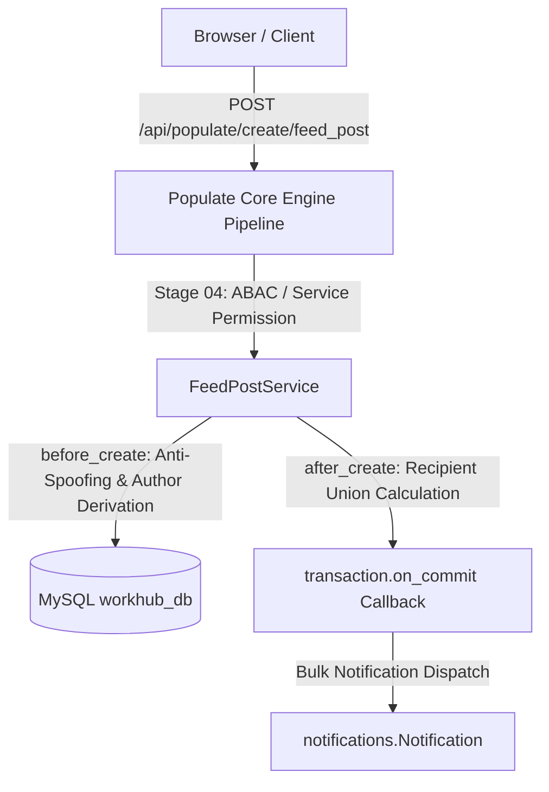

# Feed & Team Collaboration Module Brain (Django + Populate Core)

## Overview
The Feed & Collaboration module serves as the primary communication and social enterprise hub for Workhub Tracker. It facilitates organizational broadcasts, departmental group channels, interactive posts with rich attachments/polls/reactions, nested commenting threads with atomic counter rollups, and private 1-on-1 team direct messaging.

All operations flow strictly through the 10-stage Populate Core Engine (`/api/populate/:action/:model/`) on MySQL (`workhub_db`), utilizing domain services in `feed/services.py` with zero custom controllers.

---

## 🏗️ Architecture & Component Relations

---

## 🗄️ Backend Models (`feed/models.py`)

| Model | Table | Type | Description | Key Fields | Composite Indexes |
| :--- | :--- | :--- | :--- | :--- | :--- |
| **FeedGroup** | `feed_groups` | Master | Discussion groups for departments or project squads. | `name`, `members` (M2M), `created_by`, `status` | `(status, name)` |
| **FeedChannel** | `feed_channels` | Master | Scoped channels linked to groups or external clients. | `name`, `groups` (M2M), `members` (M2M), `is_external`, `allowed_clients` (M2M), `created_by` | `(status, name)` |
| **FeedPost** | `feed_posts` | Transaction | Feed updates, announcements, questions, polls. | `author`, `post_type`, `subject`, `content`, `attachments`, `group`, `channel`, `channels` (M2M), `is_broadcast`, `poll_options`, `mentions` (M2M), `reactions`, `comments_count`, `views_count`, `followers` (M2M) | `(status, post_type, created_at)` `(status, channel_id, created_at)` `(status, group_id, created_at)` `(status, is_broadcast, created_at)` |
| **FeedComment** | `feed_comments` | Transaction | Post comments and replies with mentions. | `post`, `author`, `content`, `attachments`, `mentions` (M2M), `reactions`, `replies` | `(status, post_id, created_at)` |
| **TeamMessage** | `team_messages` | Transaction | Private 1-on-1 direct messaging and chat history. | `conversation_id`, `sender`, `recipient`, `message`, `message_type`, `attachments`, `status` (`sent`, `delivered`, `read`), `sent_at`, `delivered_at`, `read_at`, `reply_to` | `(lifecycle_status, conversation_id, sent_at)` `(lifecycle_status, recipient_id, status)` `(lifecycle_status, sender_id, recipient_id)` |

---

## ⚙️ Backend Services & Security Governance (`feed/services.py`)

### 1. `FeedPostService`
- **Anti-Spoofing & Sender Derivation**:
  - `data["author_id"]` is strictly derived from `context.user.id`.
  - Client attempts to supply another user's ID as `author` are rejected with `AuthorizationError(403)`.
- **Channel & Group Access Gates**:
  - If posting to an external channel (`is_external=True`), the service verifies that the user belongs to `channel.members` or `channel.allowed_clients`.
  - If posting to a group, the service validates that the user is an active member of `group.members`.
- **Multi-Channel Recipient Union (Zero Notification Gaps)**:
  - In `after_create`, eligible notification recipients are computed as the union set of:
    1. All active users (if `is_broadcast=True`).
    2. Primary `channel.members`.
    3. Additional multi-channels (`channels.members`).
    4. Group members (`group.members`).
    5. Mentioned users (`mentions`).
  - Deduplicates user IDs and explicitly excludes `author_id`. Dispatches via bulk insert inside `transaction.on_commit` with structured logging.
- **Row-Level Read Scoping (`get_policy_scope` & `before_read`)**:
  - Non-superadmin users can only view posts if:
    - `is_broadcast=True`
    - General feed post (channel and group are null)
    - Channel is internal (`is_external=False`) or user is in `channel.members`
    - User is in `group.members`
    - User is the post `author`

### 2. `FeedCommentService`
- **Atomic Counter Rollup**:
  - In `after_create`, executes `FeedPost.objects.filter(id=post_id).update(comments_count=models.F("comments_count") + 1)`.
- **Auto-Follow**: Commenter is automatically added to post followers.
- **Comment Mentions & Recipient Union**:
  - Notifies post author, post followers, and mentioned users (`instance.mentions`), excluding the comment author.
- **Access Guard**:
  - Non-author users cannot edit comment content. Only comment author, post author, or superadmin can delete comments.

### 3. `TeamMessageService` (1-on-1 Direct Chat)
- **Sender Anti-Spoofing & Self-Messaging Prevention**:
  - `sender_id` is derived exclusively from `context.user.id`. Client spoofing attempts are rejected.
  - Messaging oneself (`sender_id == recipient_id`) is strictly rejected with a validation error.
- **Deterministic Conversation ID**:
  - Computed via sorted string comparison: `f"{min(str(sender_id), str(recipient_id))}_{max(str(sender_id), str(recipient_id))}"`.
  - Works identically for integer PKs, UUIDs, or slug identifiers.
- **Strict State-Machine Validation (`before_update`)**:
  - Valid transitions: `sent` -> `delivered` -> `read`.
  - Backward transitions (e.g., `read` -> `sent`) are rejected.
  - Only the `recipient` (or superadmin) is authorized to transition message delivery/read status. Senders are forbidden from marking their own sent messages as read.
  - Timestamps (`delivered_at`, `read_at`) are generated strictly on the server via `timezone.now()`; arbitrary client timestamps are stripped.
- **Strict Privacy Scoping (`before_read`)**:
  - Direct message read queries are filtered to `Q(sender=context.user) | Q(recipient=context.user)`.
  - Third-party users cannot query, inspect, or intercept other users' private direct messages.

---

## 🔗 Unified API Reference

All requests route through `/api/populate/:action/:model/`:

| Capability | Method | Endpoint | Example Payload / Filters |
| :--- | :--- | :--- | :--- |
| **Create Group** | POST | `/api/populate/create/feed_group/` | `{"name": "Backend Guild", "description": "Core engineers"}` |
| **Create Channel** | POST | `/api/populate/create/feed_channel/` | `{"name": "engineering", "is_external": false}` |
| **Create Post** | POST | `/api/populate/create/feed_post/` | `{"content": "Kickoff meeting at 3 PM", "channel": 1, "post_type": "Announcement"}` |
| **Add Comment** | POST | `/api/populate/create/feed_comment/` | `{"post": 1, "content": "Looking forward to it!", "mentions": [2]}` |
| **Toggle Reaction** | POST | `/api/populate/update/feed_post/:id/` | `{"reaction": {"reaction_type": "like"}}` |
| **Send Direct Message**| POST | `/api/populate/create/team_message/` | `{"recipient": 2, "message": "Can you review PR #42?"}` |
| **Mark DM Delivered** | POST | `/api/populate/update/team_message/:id/`| `{"status": "delivered"}` (Recipient only) |
| **Mark DM Read** | POST | `/api/populate/update/team_message/:id/`| `{"status": "read"}` (Recipient only) |
| **Read Direct Messages**| POST | `/api/populate/read/team_message/` | `{"filter": {"conversation_id": "1_2"}}` (Sender & Recipient only) |

---

## 🧪 Verification & Test Suite
The module includes automated tests in `feed/tests.py`:
- `python manage.py test feed`
- Validates 14 production gates including identity spoofing rejection, self-messaging prevention, deterministic chat IDs, state-machine transitions, multi-channel recipient unions, atomic comment rollups, and private query scoping.
